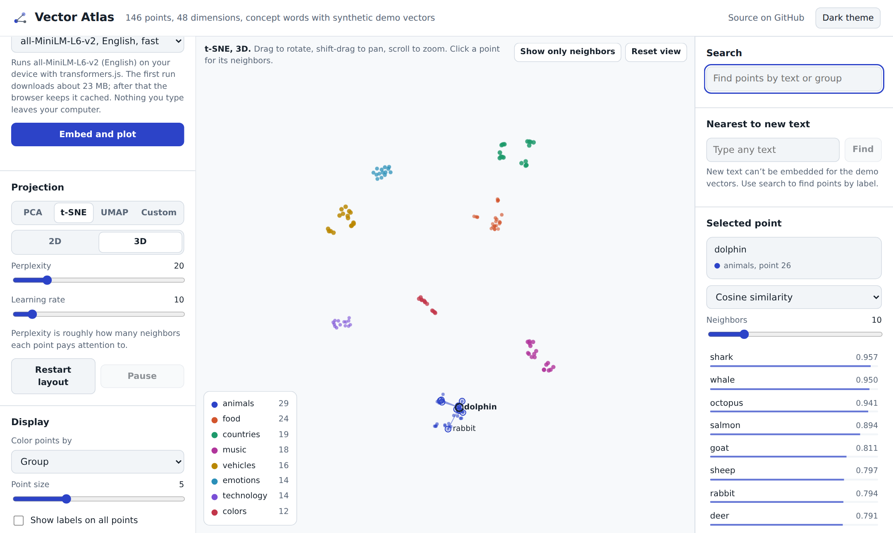
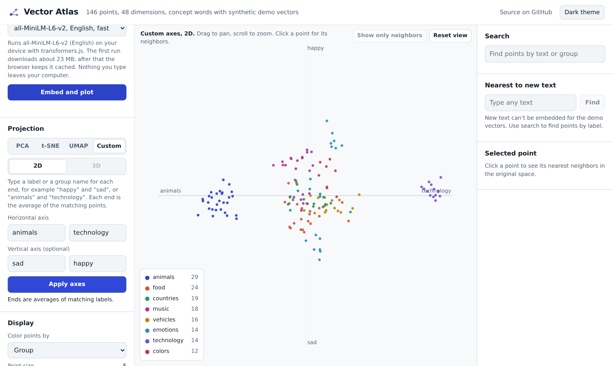

# Vector Atlas

**Explore text embeddings in your browser.** Type your own sentences, embed them with a real neural model that runs on your device, and explore the result in an interactive 3D map with PCA, t-SNE, UMAP or custom semantic axes. Inspired by TensorFlow's [Embedding Projector](https://projector.tensorflow.org/).

**[Live demo](https://mukesh9871.github.io/vector-atlas/)** &nbsp;|&nbsp; No install, no server, no API key.

[](https://github.com/mukesh9871/vector-atlas/actions/workflows/test.yml)



## Features

- **Embed your own text in the browser.** Runs `all-MiniLM-L6-v2` (or a multilingual MiniLM) through [transformers.js](https://github.com/huggingface/transformers.js) and ONNX Runtime Web. Text never leaves the visitor's computer.
- **A fast offline fallback.** A TF-IDF embedder over words, word pairs and character n-grams, hashed into a fixed-size vector, for instant results without downloading a model.
- **Bring your own vectors.** Paste or upload vectors from any model (OpenAI, Cohere, sentence-transformers, word2vec) as TSV, CSV or JSON, with optional metadata. The format matches the TensorFlow projector's `vectors.tsv` and `metadata.tsv`.
- **Four projections:** PCA (with explained variance), t-SNE and UMAP (both animate while they converge), and **custom axes**, where you define what each end of an axis means, such as "sad" to "happy".
- **Nearest neighbor search** in the original high-dimensional space, with cosine similarity or Euclidean distance.
- **Place new text on the map.** Type any sentence and it appears among the points it is most similar to.
- **Automatic clustering** with k-means, color by group or cluster, fade groups from the legend, isolate a point's neighbors.
- **Custom canvas renderer** for 2D and 3D with perspective, depth sorting, label collision avoidance, orbit, pan, pinch-zoom and keyboard controls.
- Export vectors as JSON and projected coordinates as CSV. Light and dark themes. Works on phones.



## How it works

```
text lines ──► embedder ──► vectors (n × d) ──► projection ──► 2D/3D coordinates ──► canvas renderer
               neural or                         PCA, t-SNE,                            + neighbors, search,
               TF-IDF hash                       UMAP, custom                             clusters, labels
```

| Piece | Approach |
| --- | --- |
| Neural embeddings | Sentence-transformer models in ONNX format, mean pooled and L2 normalized, run with transformers.js in WebAssembly. The model is cached by the browser after the first download. |
| Lexical embeddings | TF-IDF weights on words, bigrams and 3 to 5 character n-grams, projected into 256 to 1,024 dimensions with the signed hashing trick. |
| PCA | Power iteration with deflation, computed as `Xᵀ(Xv)` so cost stays at O(n·d) per step even for wide vectors (1,536-dimensional OpenAI embeddings, for example). |
| t-SNE | Exact t-SNE written from scratch: perplexity calibrated by binary search, early exaggeration, momentum and adaptive gains. Vectors are first reduced with a Gaussian random projection to keep it fast. |
| UMAP | [umap-js](https://github.com/PAIR-code/umap-js), stepped one epoch per animation frame so the layout visibly settles. |
| Custom axes | Each axis is the direction between two embedded phrases (or averages of matching labels for imported data). When only one axis is set, the other is the main direction of remaining variance, found with PCA after projecting the first axis out. |
| Clustering | k-means on unit vectors (spherical k-means) with k-means++ seeding. |

Everything except the neural model and UMAP is plain JavaScript with no dependencies and no build step.

## Run it locally

ES modules need to be served over HTTP, so open it through a small local server:

```bash
git clone https://github.com/mukesh9871/vector-atlas.git
cd vector-atlas
npm start               # or: python3 -m http.server 8000
```

Then visit `http://localhost:8000`.

## Tests

The math, embedding and parsing modules are covered by unit tests using Node's built-in test runner (Node 18 or newer, no packages to install):

```bash
npm test
```

The tests check, among other things, that PCA components are orthonormal and sorted by variance, that t-SNE keeps separated clusters together, and that k-means recovers known groups. They run on every push through GitHub Actions.

## Using your own vectors

Vectors go in the **Import** tab: one vector per line, values separated by tabs, commas or spaces. If the first field is text, it becomes the label. JSON works too:

```json
[{ "text": "a sentence", "group": "news", "vector": [0.12, -0.4, 0.88] }]
```

Metadata is optional: one label per line, or a tab-separated table whose first row is the header (you can choose the label and group columns after loading). To create both files with Python:

```python
from sentence_transformers import SentenceTransformer
texts = open("texts.txt").read().splitlines()
vecs = SentenceTransformer("all-MiniLM-L6-v2").encode(texts, normalize_embeddings=True)
open("vectors.tsv", "w").write("\n".join("\t".join(f"{x:.5f}" for x in v) for v in vecs))
open("metadata.tsv", "w").write("\n".join(t.replace("\t", " ") for t in texts))
```

## Project structure

```
vector-atlas/
├── index.html          page layout and controls
├── styles.css          design tokens, light and dark themes, responsive layout
├── js/
│   ├── app.js          state, projections, canvas renderer, interaction
│   ├── math.js         PCA, t-SNE, k-means, random projection, vector helpers
│   ├── embedders.js    neural (transformers.js) and lexical (TF-IDF hashing) embedders
│   ├── parsers.js      TSV, CSV and JSON vector and metadata parsing
│   └── samples.js      built-in sample datasets
├── tests/core.test.js  unit tests (node --test)
└── docs/               screenshots
```

## Deploying to GitHub Pages

1. Push the repository to GitHub.
2. In the repository, open **Settings → Pages**.
3. Under **Build and deployment**, choose **Deploy from a branch**, select `main` and `/ (root)`, then save.
4. After a minute the site is live at `https://mukesh9871.github.io/vector-atlas/`.

## Limitations and ideas

- t-SNE is exact (O(n²)), so it is capped at 1,500 points. A Barnes-Hut version would raise that.
- Heavy computation runs on the main thread; moving it to a Web Worker would keep the interface responsive on large datasets.
- Next steps: WebGL rendering for 50k+ points, shareable URLs that encode the view, and comparing two models side by side.

## Acknowledgements

- Inspired by the [TensorFlow Embedding Projector](https://projector.tensorflow.org/).
- [transformers.js](https://github.com/huggingface/transformers.js) by Hugging Face and [umap-js](https://github.com/PAIR-code/umap-js) by Google PAIR.
- t-SNE follows the approach of van der Maaten and Hinton (2008) and Andrej Karpathy's tsnejs.

## License

[MIT](LICENSE)
